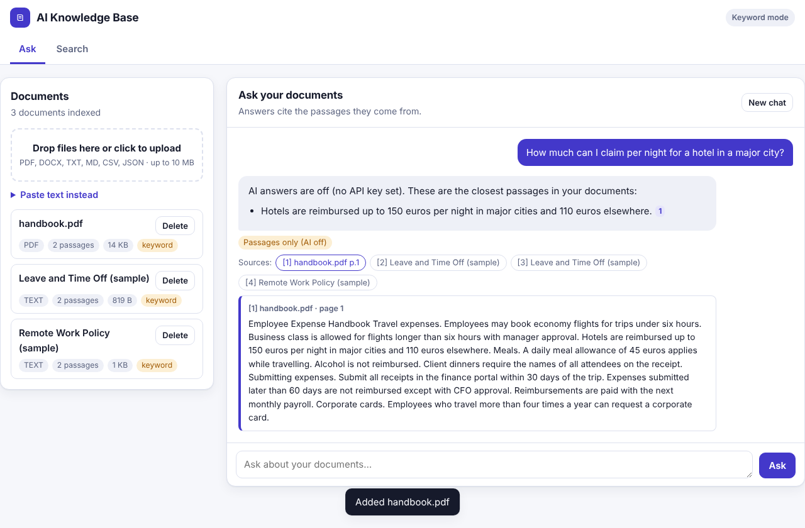
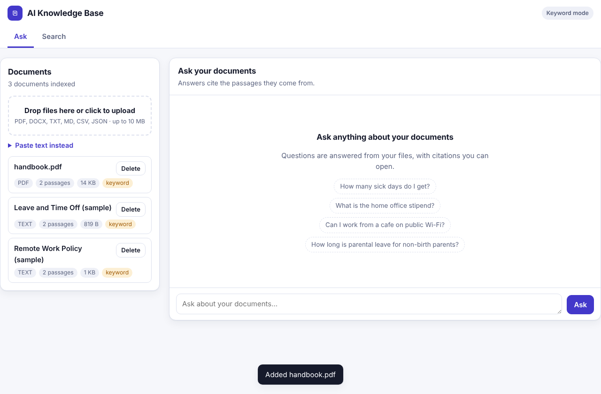
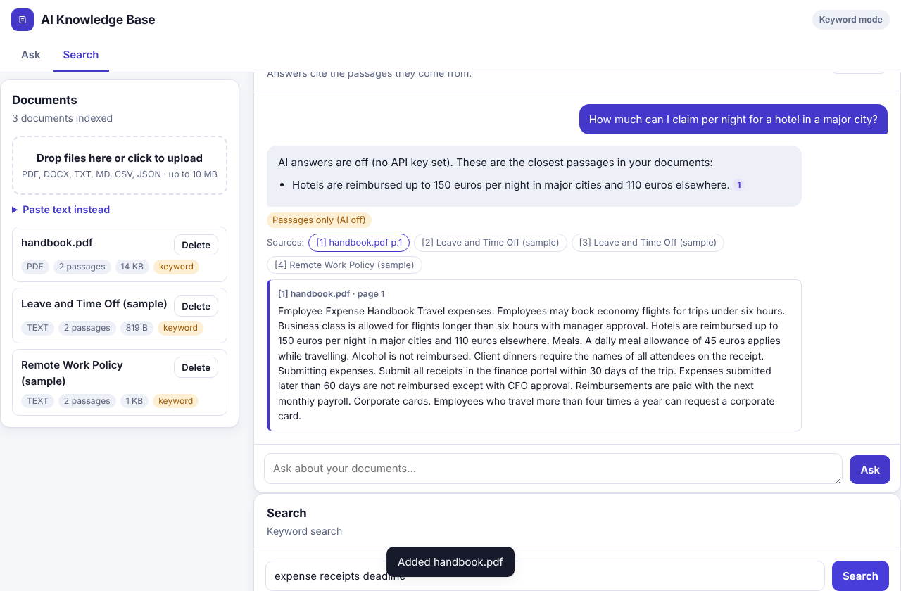
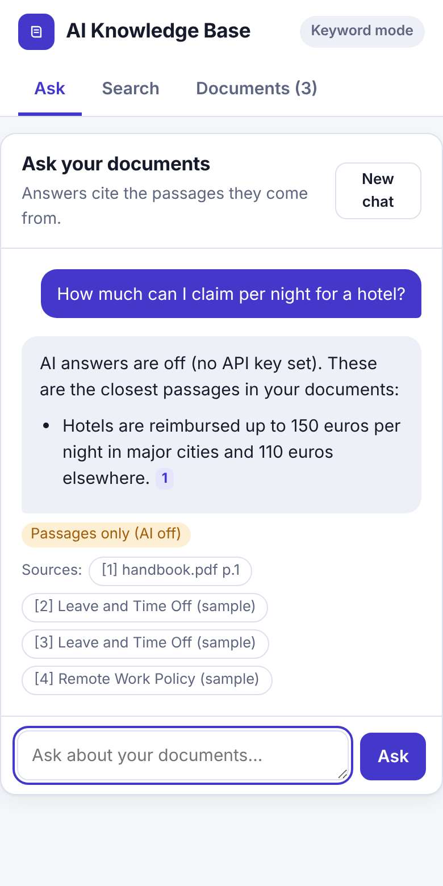
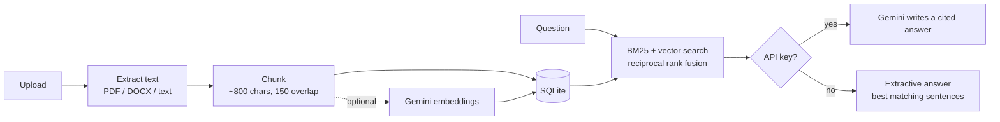

# AI Knowledge Base

Upload your documents, then ask questions in plain English and get answers with citations pointing at the exact passages they came from.



## Features

- **Upload PDF, DOCX, TXT, Markdown, CSV, JSON and more**, by drag-and-drop, or paste text directly.
- **Cited answers.** Every claim carries a `[n]` marker. Click it to see the source passage and its page.
- **Hybrid search.** BM25 keyword ranking and semantic (embedding) similarity are merged with reciprocal rank fusion.
- **Works without an API key.** With no key the app falls back to keyword search and shows the best-matching sentences from your documents. Add a Gemini key and you get written answers plus semantic search.
- **Prompt-injection aware.** Document text is passed to the model as untrusted data, and the model is told never to follow instructions found in it.
- **Mobile-friendly UI** with light and dark themes. No build step and no front-end dependencies.
- **Sample documents** you can load with one click to try it out.

## Screenshots

| Library | Search | Mobile |
|---|---|---|
|  |  |  |

The screenshots were taken without an API key, so they show keyword mode.

## How it works



## Quick start

Requires Python 3.12+.

```bash
git clone https://github.com/Valentina14142000/ai-knowledge-base.git
cd ai-knowledge-base
python3 -m venv .venv
source .venv/bin/activate
pip install -r requirements.txt
cp .env.example .env
uvicorn app.main:app --reload
```

Open http://localhost:8000. Click **Load sample documents** to try it straight away.

To turn on AI answers and semantic search, put a free [Gemini API key](https://aistudio.google.com/apikey) in `.env` as `GEMINI_API_KEY`.

## Configuration

| Variable | Default | Purpose |
|---|---|---|
| `GEMINI_API_KEY` | *(unset)* | Enables AI answers and semantic search. `GOOGLE_API_KEY` also works. |
| `GEMINI_MODEL` | `gemini-flash-latest` | Preferred generation model. Fallbacks are tried automatically. |
| `DATABASE_PATH` | `knowledge.db` | SQLite file location. On Vercel or Lambda it defaults to `/tmp`. |

## API

| Method | Path | Description |
|---|---|---|
| GET | `/api/health` | Status and whether AI is enabled |
| GET | `/api/stats` | Document and chunk counts |
| GET | `/api/documents` | List documents |
| POST | `/api/documents?filename=name.pdf` | Upload a file (raw request body, max 10 MB) |
| POST | `/api/documents/text` | Add pasted text: `{"name": "...", "text": "..."}` |
| POST | `/api/documents/samples` | Load the sample documents |
| GET / DELETE | `/api/documents/{id}` | Fetch or delete one document |
| POST | `/api/search` | `{"query": "...", "limit": 8}` returns ranked passages |
| POST | `/api/chat` | `{"question": "...", "history": [...]}` returns an answer with sources |

Interactive docs are served at `/docs`.

## Deploying

### Render (recommended)

1. Push this repo to GitHub.
2. In Render choose **New, then Blueprint**, and select the repo. `render.yaml` configures everything.
3. Optionally set `GEMINI_API_KEY` in the service's environment settings.

Or create a Web Service by hand with build command `pip install -r requirements.txt`, start command `uvicorn app.main:app --host 0.0.0.0 --port $PORT` and health check path `/health`.

### Docker

```bash
docker build -t ai-knowledge-base .
docker run -p 8000:8000 -e GEMINI_API_KEY=your-key ai-knowledge-base
```

### Things to know

- **Storage is ephemeral on free hosting.** Render's free tier and Vercel reset the disk on restart or redeploy, so uploaded documents disappear. Attach a persistent disk and point `DATABASE_PATH` at it if you need them to stay.
- **There is no login.** Anyone with the URL can upload, read and delete documents. Do not upload confidential files to a public deployment.
- **Limits:** 10 MB per file, 600,000 characters per document, 60 documents, 6,000 chunks in total. Search and chat are rate-limited per IP.

## Tests

```bash
pip install -r requirements-dev.txt
python -m pytest -q
```

CI runs the suite on every push (`.github/workflows/ci.yml`).

## Project layout

```
app/
  main.py            FastAPI app, security headers, static UI
  config.py          Settings and limits
  db.py              SQLite schema
  api/routes.py      HTTP endpoints
  services/          extract, chunker, gemini, index, repository, answer, ratelimit
  static/index.html  Single-file UI
tests/               Unit and API tests
```

## License

MIT
